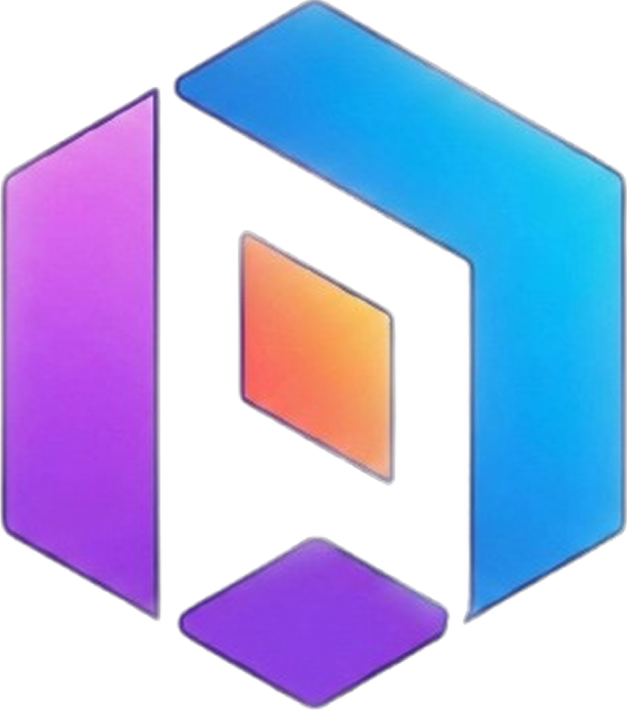

<div align="center">
  

  # QoreX

  **Billetera digital · Prototipo de aplicación móvil**

  Una experiencia financiera diseñada con **Flutter y Dart**, integrada con **Firebase**.

  <p>
    
    
    
    
  </p>
</div>

---

> **Estado:** proyecto en desarrollo. No es un servicio financiero habilitado para operar con dinero real.

## Descripción

QoreX explora la experiencia de una cuenta digital desde una aplicación móvil. El repositorio contiene interfaces y flujos relacionados con el registro, el acceso a la cuenta, las tarjetas, la recepción de operaciones, las notificaciones y el uso de códigos QR.

## Módulos del proyecto

- Registro, inicio de sesión y recuperación de contraseña.
- Pantalla de inicio y navegación de cuenta.
- Visualización, solicitud y configuración de tarjetas.
- Flujos e interfaces relacionados con pagos y recepción.
- Lectura y generación de códigos QR.
- Notificaciones, configuraciones y animaciones de interacción.
- Integraciones con servicios y capacidades del dispositivo.

La presencia de estas pantallas y módulos no implica que todas las funciones estén listas para producción.

## Tecnologías

| Área | Stack |
| --- | --- |
| Aplicación | Flutter, Dart |
| Autenticación y datos | Firebase Authentication, Cloud Firestore, Firebase Realtime Database |
| Dispositivo | Cámara, autenticación local y permisos |
| Interfaz | Lottie, SVG, componentes Flutter y animaciones |
| Códigos QR | qr_flutter, mobile_scanner |

## Ejecutar localmente

**Requisitos:** Flutter SDK, dispositivo o emulador compatible y configuración válida de Firebase para tu entorno de desarrollo.

```bash
git clone https://github.com/Nahuelete/QoreX.git
cd QoreX
flutter pub get
flutter run
```

Algunas funciones requieren permisos del dispositivo y servicios externos correctamente configurados.

## Notas de desarrollo

Este código es un prototipo. Antes de cualquier uso real con operaciones financieras serían necesarios controles de seguridad, pruebas exhaustivas, validación de operaciones y cumplimiento de los requisitos legales y regulatorios aplicables.

## Autor

[Nahuel Cappa](https://github.com/Nahuelete)
